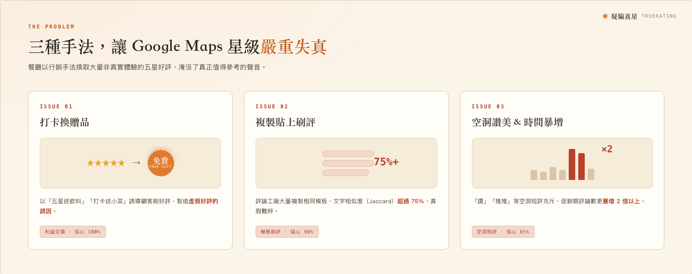
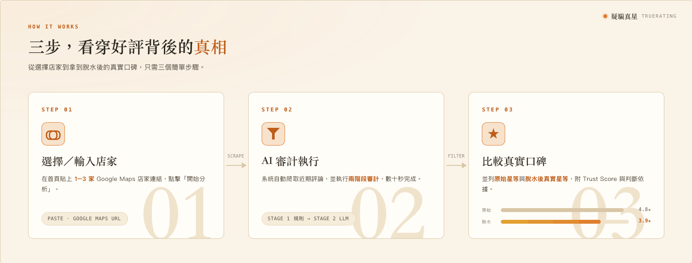
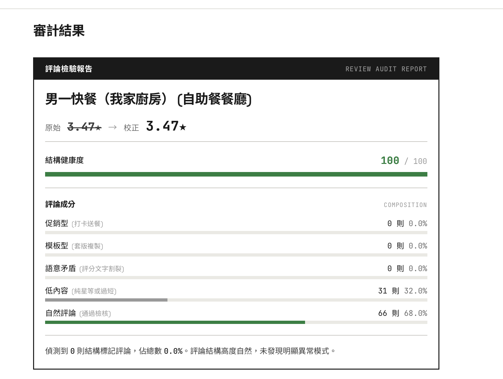

<div align="center">

# 疑騙真星 TrueRating

**Google Maps 餐廳評論真實性分析工具**

Detect fake Google Maps restaurant reviews inflated by "check-in for a free dish" promotions in Taiwan.

[](https://github.com/yiyi42205-ops/TTTTTTUUURREE/actions/workflows/ci.yml)
[](LICENSE)
[](https://truerating.fly.dev)

[線上使用](https://truerating.fly.dev) ｜ [意見回饋](https://docs.google.com/forms/d/e/1FAIpQLScXeQd2L43eDuMU_iv9GHGOedSkj3kKM-IEieeW6ieokHfA7g/viewform)

</div>

---

## 問題

台灣餐廳普遍透過「打卡送小菜」「五星送飲料」等行銷手法，換取大量非體驗導向的五星好評，導致 Google Maps 星級嚴重失真。



## 解決方案

貼上店家連結或店名 → 秒出評論可信度分析、AI 濾水後的真實星等、重點負評摘要與推薦品項。



**臺大周邊 1,500+ 家餐廳已收錄，不需要註冊或金鑰，直接查。**



---

## 核心功能

| 功能 | 說明 |
|------|------|
| **評論真實性分析** | 兩階段審計：規則引擎 + AI 語意分析，偵測利益交換、樣板化、空洞短評 |
| **真實星等還原** | 依信心指數加權，計算過濾灌水後的 Filtered Rating |
| **Trust Score** | 量化整體評論結構的可疑程度（0–100） |
| **逐條判定** | 每則評論標註類型、信心度、I/A/D 語意維度分數 |
| **AI 避雷提示** | 從真實評論中萃取反覆被提及的缺點，附來源 |
| **AI 問答** | 根據真實評論回答「推薦什麼菜？」「服務態度如何？」 |

---

## 快速開始

### 一鍵啟動 (macOS)

```bash
git clone https://github.com/yiyi42205-ops/TTTTTTUUURREE.git
cd TTTTTTUUURREE
./run.sh
```

自動建立 Python venv、安裝依賴、提示設定 `.env`，然後同時啟動前後端。

### 手動啟動

```bash
# 1. 環境變數
cp .env.example .env
# 填入 GEMINI_API_KEY（選填，無則為純快取模式）
# 填入 APIFY_TOKEN（選填，僅即時爬取需要）

# 2. 安裝
npm i
cd review_scraper && python -m venv venv && source venv/bin/activate && pip install -r requirements.txt && cd ..

# 3. 啟動（兩個 terminal）
npm run dev:scraper   # Flask 後端 :5001
npm run dev           # Vite 前端 (proxy /api → :5001)
```

### 測試

```bash
npm test                                           # vitest（前端，15 tests）
review_scraper/venv/bin/python -m pytest tests/    # pytest（後端，165 tests）
```

---

## 系統架構

```
使用者輸入 Google Maps 店家連結或店名
        │
        ▼
┌─────────────────────────┐
│  資料層                   │  SQLite 快取（臺大周邊 1,500+ 家）
│  Cache hit → 秒出結果     │  Cache miss → Apify 即時爬取
└─────────────────────────┘
        │
        ▼
┌─────────────────────────┐
│  Stage 1：規則引擎        │  促銷關鍵字、樣板相似度、
│  rule_engine.py          │  時間密度異常、low_info 偵測
└─────────────────────────┘
        │ ambiguous 評論
        ▼
┌─────────────────────────┐
│  Stage 2：LLM 語意複審    │  Gemini 2.5 Flash Lite
│  三維度 I/A/D 評分        │  server-side，key 不到前端
└─────────────────────────┘
        │
        ▼
┌─────────────────────────┐
│  加權計分引擎             │  confidence → weight
│  aggregateAuditedReviews │  Filtered Rating / Trust Score
└─────────────────────────┘
```

判斷邏輯的完整數學公式請參閱 [`docs/TRUE_RATING_LOGIC.md`](./docs/TRUE_RATING_LOGIC.md)。

---

## 技術棧

| 層級 | 技術 |
|------|------|
| 前端 | Vite + React 18 (TypeScript)、Tailwind v4 |
| 後端 | Flask (Python)、gunicorn |
| 爬蟲 | Apify（主路徑）；Playwright + stealth（可選備援） |
| AI 引擎 | Gemini 2.5 Flash Lite（預設）、DeepSeek、OpenAI 相容 |
| 資料庫 | SQLite（persistent volume） |
| 部署 | Fly.io（CI/CD via GitHub Actions） |

---

## 專案結構

```
├── src/                    前端 (React + TypeScript)
│   ├── app/pages/          Analyzer, Results, History, Settings, Home
│   ├── app/components/     TutorialModal, ReviewInspector, StoreVerdict
│   └── app/utils/          auditEngine.ts (types + Stage 2 functions)
├── review_scraper/         後端 (Flask)
│   ├── server.py           API endpoints
│   ├── rule_engine.py      Stage 1 規則引擎（唯一實作）
│   ├── llm_client.py       LLM batching + validation + typo recovery
│   ├── stage2_rules.py     Stage 2 post-LLM 判定邏輯
│   ├── cache_store.py      SQLite cache layer
│   ├── apify_scraper.py    Apify actor wrapper
│   └── normalize.py        Review 格式統一
├── scripts/                批次預跑腳本
├── eval/                   離線評估（非測試套件）
├── restaurant_data/        人工標注 CSV（18 家，6,000+ 則）
├── tests/                  pytest (165) + vitest (15)
└── docs/                   設計文件與數學公式
```

---

## 適用範圍與限制

- **地區**：台灣（規則與 prompt 專為繁體中文餐飲評論設計）
- **語言**：僅支援繁體中文
- **資料庫**：已收錄臺大周邊 1,500+ 家，其他區域需使用者提供免費 Apify Token 即時爬取
- **樣本**：單次分析約 100–500 則最新評論
- **邊界**：「真實但話少的客人」與「敷衍洗評」文字特徵難以區分，存在誤判風險

---

## Contributing

歡迎提交 Issue 和 PR。所有程式碼變更請走 PR 流程，文件可直接推 main。

---

## License

[MIT](LICENSE)

---

## 免責聲明

本系統為學術研究專案，分析結果僅供消費決策參考，不代表對特定商家之品質評價。評論審計基於統計模型與 AI 語意分析，可能存在誤判。本站不對分析結果的準確性或完整性作任何保證。
