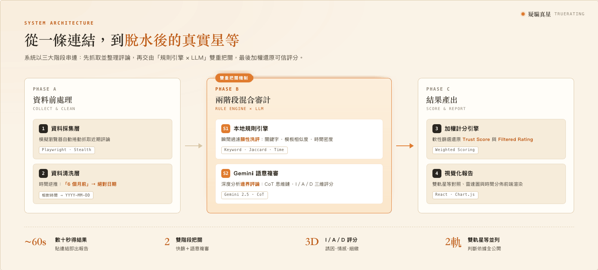

# 疑騙真星 TrueRating

> 一鍵分析 Google Maps 餐廳評論真實性，揪出「打卡送禮」換來的灌水五星，還原最接近真實體驗的星等。

許多餐廳透過「打卡送小菜」「五星送飲料」等行銷手法，換取大量非體驗導向的五星好評，導致 Google Maps 星級嚴重失真。本系統讓使用者只需貼上店家連結或店名，即可秒出評價可信度分析、AI 濾水後的真實星等，以及重點負評摘要與推薦品項。


---

## 核心功能

- **評論真實性分析** — 偵測利益交換評論、樣板化評論與空洞短評
- **真實星等還原** — 依信心指數加權，計算 Filtered Rating
- **信任度評分** — Trust Score 量化整體評論生態可疑程度
- **逐條判定理由** — 每則評論標註 issueType 與 I/A/D 語意維度分數
- **店家總結** — AI 自動產出避雷提示與推薦品項
- **AI 問答** — 根據真實評論回答使用者問題（支援 Gemini / DeepSeek / OpenAI 相容）

---

## 系統架構



兩階段混合式審計流水線：

```
使用者輸入 Google Maps 店家連結或店名
        │
        ▼
┌─────────────────────────┐
│  資料層                   │  SQLite 快取（已收錄臺大周邊 1,500+ 家）
│  Cache hit → 秒出結果     │  Cache miss → Apify 即時爬取
└─────────────────────────┘
        │
        ▼
┌─────────────────────────┐
│  Stage 1：規則引擎        │  促銷關鍵字、樣板相似度、
│  Python (rule_engine.py) │  時間密度異常、low_info 偵測
└─────────────────────────┘
        │ (5 星 ambiguous 評論)
        ▼
┌─────────────────────────┐
│  Stage 2：LLM 語意複審    │  Gemini 2.5 Flash Lite
│  三維度 I/A/D 評分        │  server-side，key 不到前端
└─────────────────────────┘
        │
        ▼
┌─────────────────────────┐
│  加權計分引擎             │  confidence → weight
│  aggregateAuditedReviews │  Filtered Rating / Trust Score
└─────────────────────────┘
```

判斷邏輯的完整數學公式請參閱 [`docs/TRUE_RATING_LOGIC.md`](./docs/TRUE_RATING_LOGIC.md)。

---

## 技術棧

| 層級 | 技術 |
|------|------|
| 前端 | Vite + React 18 (TypeScript)、Tailwind v4 |
| 後端 | Flask (Python)、gunicorn |
| 爬蟲 | Apify (主路徑)；Playwright + stealth (可選備援) |
| AI 引擎 | Gemini 2.5 Flash Lite (預設)、DeepSeek、OpenAI 相容 |
| 資料庫 | SQLite (8 tables, persistent volume) |
| 部署 | Fly.io (CI via GitHub Actions, CD on push to main) |

---

## 快速開始

### 一鍵啟動 (macOS)

```bash
./run.sh
```

自動建立 Python venv、安裝依賴、提示設定 `.env`，然後同時啟動前後端。

### 手動啟動

```bash
# 1. 設定環境變數
cp .env.example .env
# 填入 GEMINI_API_KEY（必要）、APIFY_TOKEN（選填）

# 2. 安裝
npm i
cd review_scraper && python -m venv venv && source venv/bin/activate && pip install -r requirements.txt && cd ..

# 3. 啟動（兩個 terminal）
npm run dev:scraper   # Flask 後端 :5001
npm run dev           # Vite 前端 (proxy /api → :5001)
```

### 測試

```bash
npm test                                           # vitest (前端)
review_scraper/venv/bin/python -m pytest tests/    # pytest (後端)
```

---

## 使用方式


1. 輸入 Google Maps 網址、分享連結，或直接打店名
2. 資料庫已收錄的店家秒出結果，不需要任何 API 金鑰
3. 未收錄的店家需要 Apify Token（免費帳號每月 $5 額度）
4. 報告包含：原始 vs 過濾後星等、Trust Score、評論成分、逐條判定

---

## 專案結構

```
TrueRating/
├── src/                    前端 (React + TypeScript)
│   ├── app/pages/          Analyzer, Results, History, Settings, Home
│   ├── app/components/     TutorialModal, ReviewInspector, DisclaimerModal
│   └── app/utils/          auditEngine.ts (types + Stage 2 functions)
├── review_scraper/         後端 (Flask)
│   ├── server.py           API endpoints
│   ├── rule_engine.py      Stage 1 規則引擎（唯一實作）
│   ├── llm_client.py       Gemini/DeepSeek/OpenAI batching + validation
│   ├── stage2_rules.py     Stage 2 post-LLM 判定
│   ├── cache_store.py      SQLite cache layer (8 tables)
│   ├── prompt_builder.py   Prompt 建構 + randomized XML tags
│   ├── apify_scraper.py    Apify actor wrapper
│   ├── scraper.py          Playwright fallback
│   └── normalize.py        Review 格式統一
├── scripts/                批次腳本
│   ├── prerun_stage2.py    Stage 2 預跑 (batch Gemini)
│   └── prerun_summary.py   Store summary 預跑
├── eval/                   離線評估（非測試套件）
├── restaurant_data/        人工標注 CSV（18 家，6,000+ 則）
├── tests/                  pytest + vitest
├── docs/                   設計文件
│   └── TRUE_RATING_LOGIC.md  判斷邏輯與數學公式
├── fly.toml                Fly.io 部署設定
├── Dockerfile              容器建構
└── .github/workflows/      CI (pytest + vitest) / CD (Fly.io)
```

---

## 已知限制

- **資料庫範圍**：目前收錄臺大周邊 1,500+ 家餐廳，其他區域需使用者提供 Apify Token 即時爬取。
- **樣本範圍**：單次分析約 100–500 則最新評論。
- **語言侷限**：規則與 prompt 專為繁體中文餐飲評論設計。
- **邊界判定**：「真實但話少的客人」與「敷衍洗評」文字特徵難以區分，存在誤判風險。

---

## License

[MIT](LICENSE)

---

## 免責聲明

本系統提供的分析結果僅供參考，屬於「評論行為模式分析」而非「食品品質鑑定」或對店家的最終定論。系統同時並列官方原始星等與分析後星等，並公開判斷依據，最終評斷權保留予使用者。
