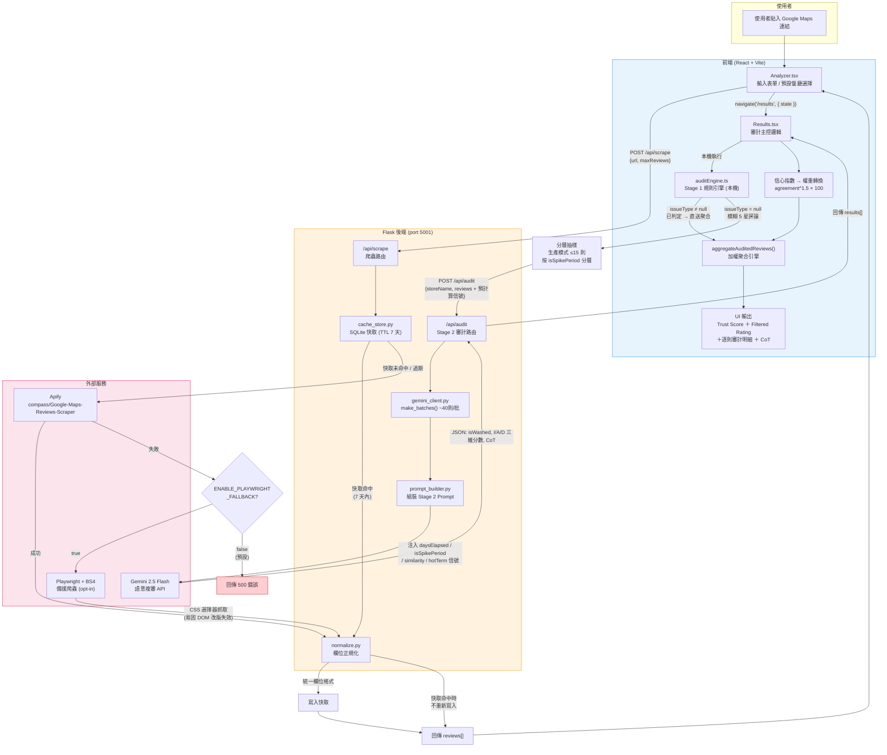
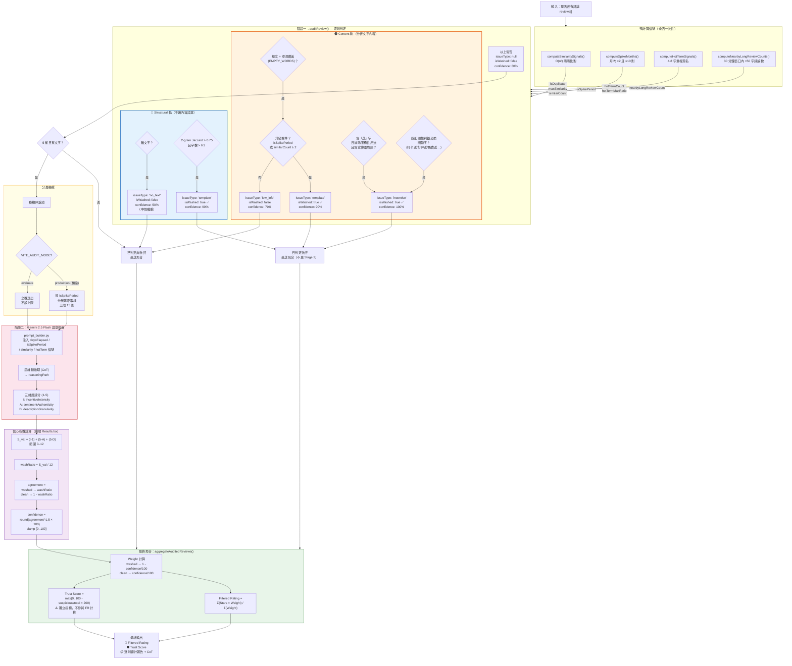
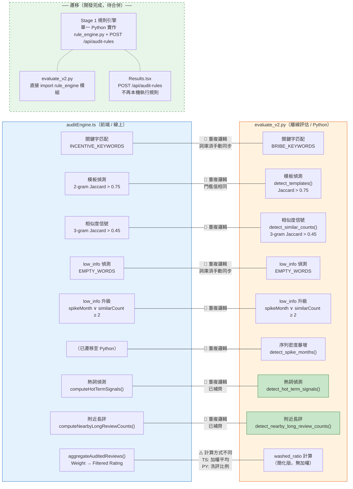

# 系統架構總覽 — TrueRating 疑騙真星

> 本文件供新加入的協作者快速理解系統全貌，也作為架構討論的共同語言。
> 圖表使用 Mermaid 格式，可在 GitHub 上直接渲染。

---

## 圖一：資料流全貌

從「使用者貼連結」到「顯示 Trust Score / Filtered Rating」的完整路徑。

### 資料流補充說明

**已定案的設計原則（不應隨意更動）：**

1. **Stage 1 判定不可被 Gemini 覆寫** — 關鍵字命中 (`incentive`) 或模板重複 (`template`) 一旦判定為洗評，不會送進 Stage 2 複審，Gemini 無權推翻。
2. **Trust Score 不參與星等計算** — `trustScore` 是獨立的信譽展示指標，`filteredRating` 純粹由加權平均決定。早期的 `trustPenalty` 機制因重複懲罰已移除，不應重新引入。
3. **Structural 訊號不依賴內容判斷** — 時間暴增 (`isSpikePeriod`)、相似度 (`similarCount`)、附近長評數 (`nearbyLongReviewCount`) 等結構訊號由本機預計算後傳給 Gemini 作為上下文，而非由 Gemini 自行計算。

**暫定參數（待調校或已在 grid search 中）：**

| 參數 | 目前值 | 所在位置 | 說明 |
|------|--------|----------|------|
| `HARD_DUPLICATE_THRESHOLD` | 0.75 | `auditEngine.ts` | 2-gram Jaccard 門檻 |
| `SIMILARITY_SIGNAL_THRESHOLD` | 0.45 | `auditEngine.ts` | 3-gram 軟信號門檻 |
| `LOW_INFO_ESCALATION_SIMILAR_COUNT` | 2 | `auditEngine.ts` | 低資訊升級觸發數 |
| `HOT_TERM_MIN_COVERAGE_RATIO` | 0.20 | `auditEngine.ts` | 熱詞覆蓋率門檻 |
| `STAGE2_CAP` | 15 | `Results.tsx` | 生產模式 Stage 2 抽樣上限 |
| Spike 門檻 | 月均 × 2 且 ≥ 10 則 | `auditEngine.ts` | 時間暴增判定 |
| 冪次指數 | 1.5 | `Results.tsx` | 信心曲線壓縮係數 |
| Trust Score 放大係數 | × 200 | `auditEngine.ts` | `100 - ratio × 200` |
| `NEARBY_WINDOW_MS` | 30 min | `auditEngine.ts` | 長評聚集偵測窗口 |
| `TARGET_BATCH_SIZE` | 40 | `gemini_client.py` | Gemini 批次大小 |
| `CACHE_TTL_SECONDS` | 604800 (7 天) | `cache_store.py` | 快取過期時間 |

---

## 圖二：審計流程細節

Stage 1 規則引擎的各個訊號軌道、Stage 2 語意複審、以及最終聚合。

### 審計流程補充說明

**Structural 軌 vs Content 軌的設計意圖：**
- **Structural 軌（藍色）**：只看評論的「形狀」——有沒有文字、跟其他評論是否重複。不解讀語意，因此對語言變化免疫。
- **Content 軌（橘色）**：分析文字內容——關鍵字匹配、空洞讚美偵測。依賴繁體中文語境，新增語言需擴充詞庫。

**已定案原則（重申）：**
- Stage 1 `issueType ≠ null` 的判定**絕不送進 Stage 2**，Gemini 只處理 Stage 1 無法判斷的模糊區間。
- `no_text` 評論的 confidence 固定 50%，對應 weight = 0.5，設計意圖是「不獎勵也不懲罰純星等評論」。

**暫定參數（此圖涉及的）：**

| 參數 | 值 | 狀態 |
|------|-----|------|
| `EMPTY_WORDS` 空洞讚美詞列表 | ~17 個詞 | 持續擴充中 |
| low_info 升級的 `similarCount` 門檻 | ≥ 2 | 待 evaluate_v2.py grid search 驗證 |
| 冪次曲線指數 | 1.5 | 經驗值，尚未做 sensitivity analysis |
| no_text confidence | 50% | 暫定，可能需依星等分級 |
| 生產模式 Stage 2 上限 | 15 則 | 成本考量，非精度最佳化結果 |

---

## 圖三：雙鏡像實作對照 — auditEngine.ts vs evaluate_v2.py

> **2026-08-08 更新：** Python 側信號鏡像已全部補齊（`detect_hot_term_signals`、`detect_nearby_long_review_counts`），並有 cross-language fixture 測試驗證一致性。遷移開發已完成（branch `feat/issue-3-rule-engine-migration`），待 PR 合併後本圖將被「單一實作」取代。

### 雙鏡像現況說明

**目前狀態：兩份獨立實作，手動同步。信號鏡像已全部補齊，由 cross-language fixture 測試驗證一致性。**

| 邏輯 | auditEngine.ts | evaluate_v2.py | 同步狀態 |
|------|---------------|----------------|---------|
| 關鍵字匹配 | `INCENTIVE_KEYWORDS` | `BRIBE_KEYWORDS` | 🔴 變數名不同，詞庫可能分歧 |
| 模板偵測 | `getNGrams(2)` + Jaccard | `detect_templates()` | 🟡 門檻相同 (0.75)，實作分開 |
| 相似度信號 | `getNGrams(3)` + 0.45 | `detect_similar_counts()` | 🟡 門檻相同，實作分開 |
| low_info + 升級 | `EMPTY_WORDS` | `EMPTY_WORDS` | 🔴 詞庫須手動同步 |
| 序列密度暴增 | — | `detect_spike_months()` | ✅ Python 唯一實作（order-based 滑窗） |
| 熱詞偵測 | `computeHotTermSignals()` | `detect_hot_term_signals()` | ✅ 已補齊，fixture 驗證 |
| 附近長評 | `computeNearbyLongReviewCounts()` | `detect_nearby_long_review_counts()` | ✅ 已補齊，fixture 驗證 |
| 聚合公式 | 加權 Filtered Rating | 簡易 washed_ratio | 🟠 設計上不同用途 |

**遷移進度：**
遷移已完成。Stage 1 規則引擎統一為 Python 單一實作（`rule_engine.py`），前端呼叫 `POST /api/audit-rules`，`evaluate_v2.py` 直接 import 共用模組。上方「auditEngine.ts」欄位中的規則邏輯已全部遷移至 Python，TS 側僅保留 Stage 2 相關函式（`computeStage2Confidence`、`mergeStage2Results`、`aggregateAuditedReviews`）和型別定義。

---

## 架構審視：畫圖過程中發現的問題

> 2026-08-08 更新：#2、#3 已解決。

### 🔴 高優先

1. **信心指數計算在前端（`Results.tsx`），不在後端**
   Gemini 回傳 `I/A/D` 三維分數後，`S_val → washRatio → agreement → confidence` 的公式是在**前端 JavaScript** 裡算的（Results.tsx L254-261），不是後端。這意味著：
   - 離線評估腳本如果要復現線上行為，必須自己重寫這段公式。
   - 後端 `/api/audit` 回傳的是 raw Gemini 分數，前端自行二次加工。如果未來有其他 client（如 CLI 工具、API 消費者），每個都要重寫信心公式。
   - **建議**：將 confidence 計算移入後端，`/api/audit` 直接回傳最終 `confidenceScore`。
   - **遷移後狀態**：遷移 branch 中 `rule_engine.py` 已包含 confidence 計算，合併後此問題將一併解決。

2. ~~**Stage 1 雙份實作的詞庫已經命名不同**~~ ✅ 已解決
   ~~TypeScript 叫 `INCENTIVE_KEYWORDS`，Python 叫 `BRIBE_KEYWORDS`。~~ Python 側已補齊所有信號鏡像，並由 cross-language fixture 測試驗證一致性。遷移合併後將只剩單一實作，徹底消除此風險。

3. ~~**Python 離線評估缺少兩個信號**~~ ✅ 已解決
   ~~`computeHotTermSignals()` 和 `computeNearbyLongReviewCounts()` 只存在於 TypeScript。~~ `detect_hot_term_signals()` 和 `detect_nearby_long_review_counts()` 已加入 `evaluate_v2.py`（commit `b7ff0a1`），並納入離線評估流程。`test_evaluate_v2_signal_mirrors.py` 以 cross-language fixture 驗證 TS/Python 輸出一致。

### 🟡 中優先

4. **資料在前後端之間繞路**
   目前的流程是：前端跑完 Stage 1 → 把預計算的信號（similarity, hotTerm, nearbyLongReview, spike）附在 review 上 → POST 到後端 → 後端只是轉交給 Gemini。前端做了所有計算，後端只是 proxy。這導致：
   - 後端無法獨立驗證收到的信號是否正確。
   - 前端為了計算 `computeSimilaritySignals()`（O(n²)）在瀏覽器裡跑可能對大量評論造成性能問題。
   - **建議**：將預計算信號移到後端，前端只送 raw reviews。

5. **`/api/scrape` 的 normalize 與 `/api/audit` 的 normalize 重複執行**
   爬蟲返回的評論已經過 `normalize_review()`，但 `/api/audit` 收到前端送回的評論後**又跑一次** `normalize_review()`。如果正規化邏輯有副作用（例如截斷文字），第二次正規化可能改變內容。

6. **Playwright fallback 預設關閉且 CSS 選擇器脆弱**
   `ENABLE_PLAYWRIGHT_FALLBACK` 預設 `false`，意味著 Apify 失敗時使用者直接看到 500 錯誤。而即使開啟，Playwright 的 Google Maps CSS 選擇器是硬編碼的，DOM 改版即失效。這條路徑缺乏自動化測試。

### 🟢 低優先 / 觀察

7. **`no_text` 的 confidence=50% 不分星等**
   一則 1 星無文字評論和一則 5 星無文字評論拿到相同的 weight (0.5)。但 5 星無文字在洗評促銷場景下遠比 1 星可疑。可能需要依星等分級。

8. **Trust Score 的 ×200 放大係數**
   `100 - ratio × 200` 意味著只要 50% 的評論被判為可疑，Trust Score 就歸零。這個係數是經驗值，沒有文件說明選擇依據。

9. **Stage 2 的 15 則上限是成本考量，非精度最佳化**
   沒有數據顯示 15 則抽樣能代表多大的母體。如果一家店有 100 則模糊評論，15 則的抽樣率只有 15%，可能遺漏模式。
