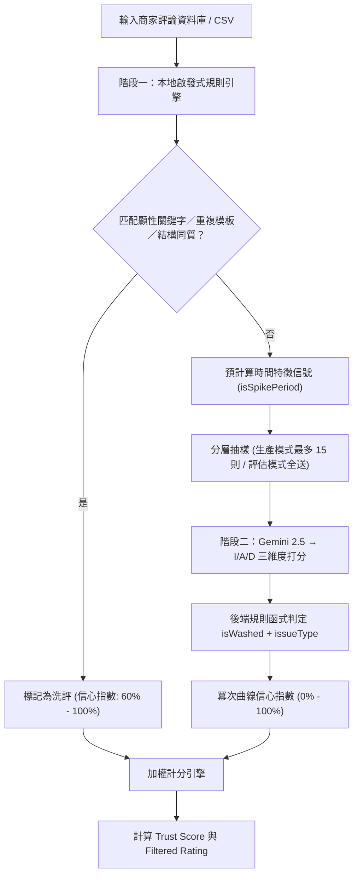

# Google Maps TrueRating 商家評價審計判斷邏輯說明

本系統目前採用**「兩階段混合式雙重審計流水線（Two-Stage Hybrid Audit Pipeline）」**來判斷 Google Maps 評論是否為「洗評（Washed）」或「真實口碑（Clean）」。以下為詳細判斷邏輯、時間特徵指標與數學加權公式。

---

## 1. 系統架構簡介

---

## 2. 階段一：本地啟發式規則引擎 (Stage 1: Local Heuristics)

此階段直接在本機瀏覽器執行，特徵匹配速度快，能瞬間過濾出最顯著的惡意洗評與打卡洗評。

### 2.1 顯性利益交換與贈送關鍵字匹配 (Explicit Bribe & Promo Send)
匹配是否含有商家常用的打卡促銷交易關鍵字，分為以下兩類檢測：
1. **直接關鍵字匹配**：包含特定組合關鍵字，如 `打卡`、`活動`、`評論送`、`打卡送`、`好評送`、`免費送`、`送小菜`、`送起司球`、`送飲料`、`送肉`、`送單點`、`送麻糬`、`送奶酪`。
2. **條件式贈送特徵匹配（避免誤判服務性「送」字）**：
   * **條件 A**：評論中出現 `送` 字，且排除常規送餐與服務性詞彙（如 `外送`、`配送`、`送禮`、`送給`、`送餐`、`送上`、`送來`、`送錯`、`送客`、`送走`、`送出`、`推送`、`面送`、`送速度`、`送口`、`送入`、`送到`、`送達`、`送桌`、`補送`、`送回`、`菜梯送`、`端送`、`發送`、`傳送`、`運送`、`送進`、`送過`、`送風`、`陸續送`）。
   * **條件 B**：同時包含宣傳性語境關鍵字（如 `好評`、`評論`、`分享`、`按讚`、`追蹤`、`關注`、`五星`、`五顆星`、`5星`、`5顆星`、`推薦`、`留言`、`截圖`、`貼文`、`社群`、`IG`、`FB`、`臉書`、`Google`、`google`）。
* **判定結果**：若符合直接關鍵字，或同時滿足條件 A 與條件 B，直接判定 `isWashed: true`、`issueType: 'incentive'`、`信心指數 (confidenceScore): 100%`。

### 2.2 Pairwise 相似度模板檢測 (Template Detection)
為防範刷評工作室使用同一套模版複製貼上：
*   **機制**：將文字去除空白後，擷取每個字元組成 **2-Gram 字符特徵**，對全店評論進行交叉比對。
*   **門檻**：若兩則評論的字數大於 6，且 **Jaccard 相似度 > 75%**：
*   **判定結果**：直接判定 `isWashed: true`、`issueType: 'template'`、`信心指數 (confidenceScore): 90%`。

### 2.6 結構同質模板檢測 (Structural Template Detection)
在 Stage 1 預計算信號之後、收集模糊評論送 Stage 2 之前，對原本會送 Stage 2 的模糊評論套用此規則。命中的評論不再送 LLM，直接在 Stage 1 判定。

*   **觸發條件**（符合任一即命中）：
    * `maxSimilarity ≥ 0.55` 且 `similarCount ≥ 2`
    * `hotTermCount ≥ 2` 且 `hotTermMaxRatio ≥ 0.3`
*   **判定結果**：`isWashed: true`、`issueType: 'template'`、`verdictBasis: 'structural'`
*   **信心指數**：加權複合公式，映射至 60–95 範圍：
    $$composite = 0.4 \times \frac{similarCount}{5} + 0.4 \times hotTermMaxRatio + 0.2 \times \frac{nearbyLongReviewCount}{5}$$
    $$confidence = 60 + composite \times 35$$
*   **門檻為暫定值**，待 PR 2 上線後以標註店家校準。

---

## 3. 輔助特徵：時間特徵信號預計算 (Temporal Signals)

在進入第二階段前，本機引擎會預先為每則評論計算兩個時間特徵，作為脈絡資訊傳遞給 Gemini AI：

1.  **歷史相對時間 (`daysElapsed`)**：
    計算評論發表至今所經歷的天數。協助 AI 理解此評論屬於歷史行為還是近期行為。
2.  **時間密度暴增特徵 (`isSpikePeriod`)**：
    統計各個月份的評論發布數，若某月份評論數大於**「歷史月平均數的 3 倍」**且該月**評論數 $\ge 10$ 則**，則該月發布的所有評論皆標記 `isSpikePeriod: true`。這代表此評論極可能發布於商家的打卡宣傳期或洗評集中期。

---

## 4. 階段二：Gemini 2.5 雲端語意複審 (Stage 2: Gemini Cloud Audit)

針對階段一未被匹配，但星等為 5 星且有文字描述的「模糊 / 高風險評論」，送交 Gemini 進行語意分析。

**抽樣策略（由 `VITE_AUDIT_MODE` 環境變數控制）：**
*   **生產模式 (`production`，預設)**：最多抽樣 15 則，按 `isSpikePeriod` 分層等距取樣，控制 Gemini API 成本。
*   **評估模式 (`evaluate`)**：全數送出，不設上限，確保離線評估的全覆蓋數字不失真。

### 4.1 LLM 輸出：I／A／D 三個分數
LLM **只輸出**每則評論的三個維度分數（1–5 整數）和一句 40 字內的 reasoning。是否為洗評（`isWashed`）、問題類型（`issueType`）、判定原因（`reason`）全部由後端程式碼根據分數產生。Prompt 不包含任何信號欄位（`stars`、`daysElapsed`、`isSpikePeriod`、`maxSimilarity` 等），LLM 只看 `{id, text}`。

三個維度：
*   **利益交換強度 (`incentiveIntensity`, $I$)**：是否有為獲得折扣/贈禮而寫的好評痕跡（1 分最弱，5 分最強）。
*   **情感真實度 (`sentimentAuthenticity`, $A$)**：情感表達是否真誠自然（1 分最假，5 分最真）。
*   **描述細緻度 (`descriptionGranularity`, $D$)**：對餐點、服務、細節描述的具體程度（1 分最空洞，5 分最細緻）。

### 4.2 規則函式（後端 `stage2_rules.py`）
LLM 回傳的 I／A／D 分數由以下規則函式判定是否洗評（門檻沿用 prompt v2，全部暫定）：

| 規則 | 條件 | 判定 |
|------|------|------|
| 規則 1：利益交換 | `I ≥ 3` 且 `D ≤ 2`；或 `I = 5` 且非（`D ≥ 4` 且 `A ≥ 4`） | `isWashed: true`、`issueType: "incentive"` |
| 規則 2：空洞模板 | `D ≤ 2` 且（`A ≤ 2` 或 `isSpikePeriod`） | `isWashed: true`、`issueType: "template"` |

`isSpikePeriod` 從 Stage 1 信號取，不經 LLM。`verdictBasis` 一律為 `"content"`（structural 已由 Stage 1 規則 2.6 在 PR 1 產生）。原 prompt 的規則 3（`A ≤ 1` 且 `D ≤ 2`）為規則 2 的子集，已併入。`discrepancy` issueType 從此不再產生。

### 4.3 冪次曲線信心指數 (Power-Curve Confidence Score)
後端收到 I／A／D 分數後，根據以下公式計算信心指數（公式不變）：

1.  **計算偏差總分 (Score Deviation)**：
    $$S_{val} = (I - 1) + (5 - A) + (5 - D)$$
    *(洗評特徵越重，$S_{val}$ 分數越高，範圍為 0 到 12 分。)*

2.  **計算一致性 (Agreement)**：
    $$washRatio = \frac{S_{val}}{12}$$
    *   若判定為洗評 (`isWashed = true`)：$agreement = washRatio$
    *   若判定為真實 (`isWashed = false`)：$agreement = 1 - washRatio$

3.  **冪次曲線信心指數**：
    $$Confidence\% = \mathrm{round}\!\left( agreement^{1.5} \times 100 \right),\quad \text{clamp to } [0, 100]$$

4.  **UI 分級門檻**：當 `isWashed = true` 且 $Confidence < 50\%$ 時，前端以琥珀色「疑似洗評」標籤取代紅色「判定：灌水洗評」。

### 4.4 Stage 2 分數快取
I／A／D 分數寫入 SQLite `stage2_scores` 表（主鍵：`review_id, model, prompt_version`），之後調門檻只重跑規則函式，不需重打 API。`prompt_version` 為 `audit_prompt.txt` 的 sha256 前 8 碼，確保新舊分數不混用。

---

## 5. 最終統計：商家信譽與過濾星等計算 (Aggregates)

系統拒絕使用非黑即白的二分法裁決，而是以**信心指數轉化為權重**進行軟性篩選 (Soft-filtering)：

*   **評論權重公式 (Weight)**：
    *   若判定為洗評 (`isWashed = true`)：
        $$Weight = 1 - \frac{Confidence}{100}$$
    *   若判定為真實 (`isWashed = false`)：
        $$Weight = \frac{Confidence}{100}$$
    *(例如：一則被 99% 信心判定為洗評的評論，其評分權重僅佔 1%，接近被完全過濾)*

*   **過濾後之真實星等 (Filtered Rating)**：
    $$Filtered\ Rating = \frac{\sum (Stars \times Weight)}{\sum Weight}$$
    純加權平均，無額外扣減。

*   **商家真實信譽評分 (Trust Score)**：
    $$Trust\ Score = \max\!\left(0,\ 100 - \frac{Suspicious\ Reviews}{Total\ Reviews} \times 200\right)$$
    Trust Score 為**獨立顯示指標**，反映「這家店的評論生態有多可疑」，**不參與 Filtered Rating 的計算**。UI 上與 Filtered Rating 並列呈現，供使用者自行參考。

> **歷史紀錄：trustPenalty 移除說明**
>
> 早期版本曾在 Filtered Rating 上額外施加一個 Trust Score 衍生的星等扣減（`trustPenalty = (100 - trustScore) * 0.02`，最高扣 2 星）。此設計導致同一批洗評的計數被重複懲罰——Weight 公式已按信心指數壓低洗評的星等貢獻，trustPenalty 又按洗評比例再次扣分，造成系統性向下偏誤（例：4.5 星 / 30% 洗評的店，Weight 過濾降 0.4 星，trustPenalty 再扣 1.2 星，後者佔總降幅 75%）。因無設計文件支持且屬歷史遺留，已於本版移除。
