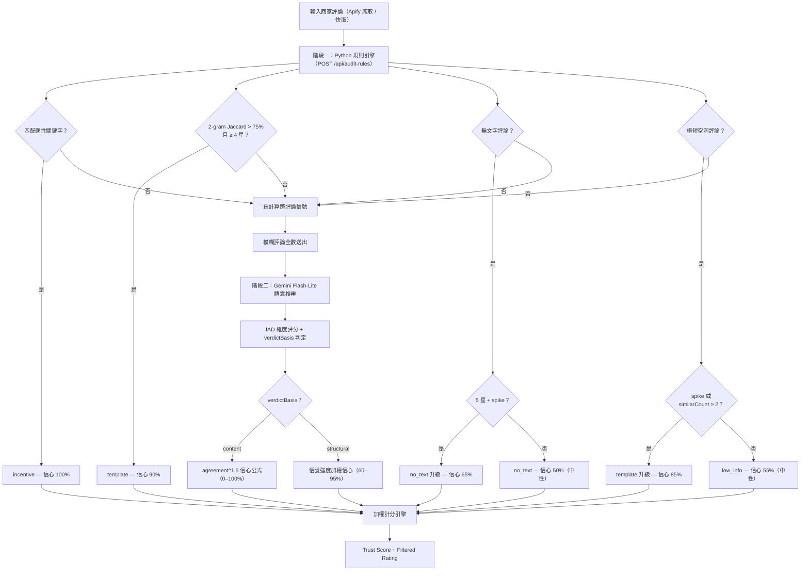

# Google Maps TrueRating 商家評價審計判斷邏輯說明

本系統目前採用**「兩階段混合式雙重審計流水線（Two-Stage Hybrid Audit Pipeline）」**來判斷 Google Maps 評論是否為「洗評（Washed）」或「真實口碑（Clean）」。以下為詳細判斷邏輯、時間特徵指標與數學加權公式。

---

## 1. 系統架構簡介

---

## 2. 階段一：規則引擎 (Stage 1: Rule Engine)

此階段在 Python 後端執行（`review_scraper/rule_engine.py`），前端透過 `POST /api/audit-rules` 呼叫。以下各規則按優先順序執行，命中即返回，不再往下檢查。

### 2.1 顯性利益交換與贈送關鍵字匹配 (`issueType: 'incentive'`)

匹配是否含有商家常用的打卡促銷交易關鍵字，分為以下三類檢測：

1. **直接關鍵字匹配**：包含特定組合關鍵字，如 `打卡`、`評論送`、`打卡送`、`好評送`、`免費送`、`送小菜`、`送起司球`、`送飲料`、`送肉`、`送單點`、`送麻糬`、`送奶酪`。
2. **「活動」條件式匹配**：`活動` 單獨出現屬多義詞（親子活動、公司活動），不直接標記。僅在同時出現宣傳性語境關鍵字（如 `送`、`打卡`、`好評`、`免費`、`贈`、`五星`、`分享`、`按讚`、`追蹤`、`留言`、`Google`、`IG`、`FB`…）時才觸發。
3. **條件式贈送特徵匹配（避免誤判服務性「送」字）**：
   * **條件 A**：評論中出現 `送` 字，且排除常規送餐與服務性詞彙（如 `外送`、`配送`、`送禮`、`送給`、`送餐`、`送上`、`送來`、`送錯`、`送客`、`送走`、`送出`、`推送`、`面送`、`送速度`、`送口`、`送入`、`送到`、`送達`、`送桌`、`補送`、`送回`、`菜梯送`、`端送`、`發送`、`傳送`、`運送`、`送進`、`送過`、`送風`、`陸續送`）。
   * **條件 B**：同時包含宣傳性語境關鍵字（如 `打卡`、`活動`、`好評`、`評論`、`分享`、`按讚`、`追蹤`、`關注`、`五星`、`五顆星`、`5星`、`5顆星`、`推薦`、`留言`、`截圖`、`貼文`、`社群`、`IG`、`FB`、`臉書`、`Google`、`google`）。
* **判定結果**：若符合直接關鍵字、「活動」+語境關鍵字、或同時滿足條件 A 與條件 B，直接判定 `isWashed: true`、`issueType: 'incentive'`、`confidenceScore: 100%`。

### 2.2 Pairwise 相似度模板檢測 (`issueType: 'template'`)

為防範刷評工作室使用同一套模版複製貼上：
*   **機制**：將文字去除空白後，擷取每個字元組成 **2-Gram 字符特徵**，對全店評論進行交叉比對。
*   **門檻**：若兩則評論的字數大於 6，且 **Jaccard 相似度 > 75%**，**且評論星等 ≥ 4 星**（低星重複評論通常為抱怨，非洗評行為）：
*   **判定結果**：判定 `isWashed: true`、`issueType: 'template'`、`confidenceScore: 90%`。

### 2.3 無文字評論 (`issueType: 'no_text'`)

*   **機制**：評論僅留星等但無文字內容。
*   **預設判定**：`isWashed: false`、`confidenceScore: 50%`（中性權重）。
*   **升級條件**：若同時為 **5 星**且處於**評論量暴增月份 (`isSpikePeriod`)**，升級為 `isWashed: true`、`confidenceScore: 65%`，符合「無文字五星集中出現」的洗評典型特徵。

### 2.4 極短空洞評論 (`issueType: 'low_info'`)

*   **機制**：比對一組預定義的空洞讚詞清單（如 `好吃`、`讚`、`推`、`棒`、`美味`、`大推`、`好喝`…共 25 個），以及重複讚詞正則（如 `讚讚讚`、`推推推`）。僅對 **4 星以上**評論生效。
*   **預設判定**：`isWashed: false`、`confidenceScore: 55%`（中性偏低權重）——短文字本身不構成洗評證據。
*   **升級條件**：若同時滿足以下任一條件，升級為 `isWashed: true`、`issueType: 'template'`、`confidenceScore: 85%`：
    *   處於評論量暴增月份 (`isSpikePeriod: true`)
    *   與店內其他評論的相似數量 `similarCount ≥ 2`
*   **短評精確匹配計數**：極短評論（字數 ≤ 6）因長度不足無法進行 n-gram Jaccard 比對（`detect_similarity_signals` 會回傳 `similarCount: 0`），系統另以精確文字匹配計算同店內相同文字的評論數量，作為 `similarCount` 的補充。

### 2.5 模糊評論 (`issueType: null`)

以上皆未命中的評論，暫時判定 `isWashed: false`、`confidenceScore: 80%`，標記為模糊評論，全數送入階段二由 LLM 語意複審。

---

## 3. 跨評論信號預計算 (Cross-Review Signals)

在進入第二階段前，規則引擎會預先為每則評論計算以下跨評論信號，作為脈絡資訊傳遞給 LLM：

| 信號 | 計算方式 | 用途 |
|------|---------|------|
| **`daysElapsed`** | 評論發表至今的天數 | 協助 LLM 判斷時間背景 |
| **`isSpikePeriod`** | 該月評論數 > 歷史月均的 3 倍，且 ≥ 10 則 | 標記暴增期間的評論 |
| **`maxSimilarity`** | 3-gram Jaccard 與同店所有評論的最高相似度 | 量化文字重複程度 |
| **`similarCount`** | 3-gram Jaccard ≥ 0.45 的同店評論數量 | 量化同質評論群聚 |
| **`hotTermCount`** | 同店 5 星評論中，≥ 3 則（或 ≥ 20%）使用的 4–8 字重複詞組數 | 偵測刷評工作室常用的固定菜名/話術 |
| **`hotTermMaxRatio`** | 上述重複詞組的最高覆蓋率（佔 5 星評論的比例） | 量化「統一話術」的強度 |
| **`nearbyLongReviewCount`** | 30 分鐘內發布的長篇評論（> 50 字）數量 | 偵測短時間內集中出現的長篇好評 |

以下為店家層級的整體信號（不在每則評論上）：

| 信號 | 計算方式 | 用途 |
|------|---------|------|
| **`spikeMonths`** | 被標記為暴增的月份列表 | 供前端顯示時間分布 |
| **`noTextRatio`** | 無文字評論佔全部評論的比例 | 反映星等灌水嚴重程度 |
| **`foreignLanguageRatio`** | 非中文評論佔有文字評論的比例（使用 langdetect，排除過短文字及 CJK 誤判） | 輔助判斷評論群體組成 |

---

## 4. 階段二：Gemini Flash-Lite 雲端語意複審 (Stage 2: LLM Cloud Audit)

針對階段一未被匹配（`issueType: null`）的模糊評論，全數送交 Gemini Flash-Lite 進行語意分析。無抽樣上限。

*   **模型**：`gemini-2.5-flash-lite`（Thinking 已關閉）。
*   **批次策略**：按 `daysElapsed` 排序後，分為每批約 40 則（最多 50 則），最多 5 批同時送出。時間相近的評論放同一批，讓 LLM 能觀察到時間群聚模式。
*   **提示詞**：由 `prompt_builder.py` 從 `audit_prompt.txt` 模板建構，包含評論資料與上述跨評論信號。

### 4.1 指標評分細分化 (1 - 5 分)

LLM 針對三個獨立維度進行打分：
*   **利益交換強度 (`incentiveIntensity`, $I$)**：是否有為獲得折扣/贈禮而寫的好評痕跡（1 分最弱，5 分最強）。
*   **情感真實度 (`sentimentAuthenticity`, $A$)**：情感表達是否真誠自然（1 分最假，5 分最真）。
*   **描述細緻度 (`descriptionGranularity`, $D$)**：對餐點、服務、細節描述的具體程度（1 分最空洞，5 分最細緻）。

### 4.2 判定依據路由 (`verdictBasis`)

LLM 同時輸出 `verdictBasis` 欄位，標明判定依據來源：

*   **`"content"`**：判定基於此則評論本身的文字內容（利益交換用語、空洞模板、情感與描述不符等）。
*   **`"structural"`**：判定基於跨評論結構性證據（同店評論同質化、固定菜名話術、時間群聚等），而非這則評論自身的文字品質。
    *   LLM 的自我檢驗：「如果遮住這則評論的文字，只看它與同店其他評論的結構性關係，我是否仍能得出相同判定？」→ 是，則標記為 structural。

### 4.3 信心指數計算 — 依 `verdictBasis` 分流

#### Content 路徑（預設）

適用於所有 `verdictBasis: "content"` 的判定（包含 incentive、content-driven template、discrepancy、clean）：

1.  **計算偏差總分 (Score Deviation)**：
    $$S_{val} = (I - 1) + (5 - A) + (5 - D)$$
    *(洗評特徵越重，$S_{val}$ 分數越高，範圍為 0 到 12 分。)*

2.  **計算一致性 (Agreement)**：
    $$washRatio = \frac{S_{val}}{12}$$
    *   若 LLM 判定為洗評 (`isWashed = true`)：$agreement = washRatio$
    *   若 LLM 判定為真實 (`isWashed = false`)：$agreement = 1 - washRatio$

3.  **冪次曲線信心指數**：
    $$Confidence\% = \mathrm{round}\!\left( agreement^{1.5} \times 100 \right),\quad \text{clamp to } [0, 100]$$
    *（冪次 1.5 將模糊中間點從 50% 壓至約 35%，使得維度評分與二元判定不一致時信心明顯降低。）*

#### Structural 路徑

適用於 `isWashed: true` 且 `issueType: "template"` 且 `verdictBasis: "structural"` 的判定。

此路徑的存在原因：以 I/A/D 公式為結構性判定計算信心會產生荒謬結果——一則文筆好、描述具體的代寫評論，其 A 和 D 分數都很高，導致 `agreement` 極低（~0.02），信心約 2%，權重約 0.98，等同完全不過濾。

改以三項結構信號的強度直接計算信心：

$$composite = 0.4 \times \frac{\min(similarCount, 5)}{5} + 0.4 \times \min(hotTermMaxRatio, 1) + 0.2 \times \frac{\min(nearbyLongReviewCount, 5)}{5}$$

$$Confidence\% = 60 + composite \times (95 - 60), \quad \text{clamp to } [60, 95]$$

| 信號 | 權重 | 封頂值 | 意義 |
|------|------|--------|------|
| `similarCount` | 40% | 5 | 同質評論數量 |
| `hotTermMaxRatio` | 40% | 1.0 | 重複話術覆蓋率 |
| `nearbyLongReviewCount` | 20% | 5 | 短時間長評群聚 |

### 4.4 UI 分級門檻

當 `isWashed = true` 且 $Confidence < 50\%$ 時，前端以琥珀色「疑似洗評」標籤取代紅色「判定：灌水洗評」，提示此判定仍具不確定性，並隱藏「二階 AI 攔截」確定性標籤。

---

## 5. 最終統計：商家信譽與過濾星等計算 (Aggregates)

系統拒絕使用非黑即白的二分法裁決，而是以**信心指數轉化為權重**進行軟性篩選 (Soft-filtering)：

*   **評論權重公式 (Weight)**：
    *   若判定為洗評 (`isWashed = true`)：
        $$Weight = 1 - \frac{Confidence}{100}$$
    *   若判定為真實 (`isWashed = false`)：
        $$Weight = \frac{Confidence}{100}$$
    *(例如：一則被 99% 信心判定為洗評的評論，其評分權重僅佔 1%，接近被完全過濾)*

*   **過濾後之真實星等 (Filtered Rating)**：
    $$Filtered\ Rating = \frac{\sum (Stars \times Weight)}{\sum Weight}$$
    純加權平均，無額外扣減。

*   **商家真實信譽評分 (Trust Score)**：
    $$Trust\ Score = \max\!\left(0,\ 100 - \frac{Suspicious\ Reviews}{Total\ Reviews} \times 200\right)$$
    Trust Score 為**獨立顯示指標**，反映「這家店的評論生態有多可疑」，**不參與 Filtered Rating 的計算**。UI 上與 Filtered Rating 並列呈現，供使用者自行參考。

> **歷史紀錄：trustPenalty 移除說明**
>
> 早期版本曾在 Filtered Rating 上額外施加一個 Trust Score 衍生的星等扣減（`trustPenalty = (100 - trustScore) * 0.02`，最高扣 2 星）。此設計導致同一批洗評的計數被重複懲罰——Weight 公式已按信心指數壓低洗評的星等貢獻，trustPenalty 又按洗評比例再次扣分，造成系統性向下偏誤（例：4.5 星 / 30% 洗評的店，Weight 過濾降 0.4 星，trustPenalty 再扣 1.2 星，後者佔總降幅 75%）。因無設計文件支持且屬歷史遺留，已於本版移除。
